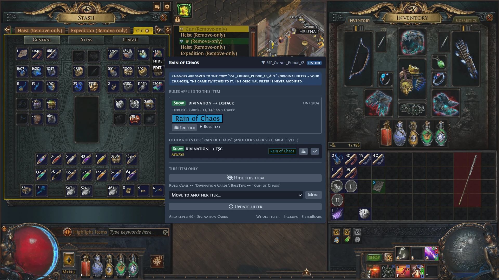

#  Awakened PoE Trade + Loot Filter Editor

A fork of [Awakened PoE Trade](https://github.com/SnosMe/awakened-poe-trade) that adds an **in-game loot filter editor**: press a hotkey on an item to see which rule of your loot filter highlights it, and hide it, move it to another tier or change the rule — without leaving the game. Works with filters from [FilterBlade](https://www.filterblade.xyz/) / NeverSink, including **online filters**.

Everything else is the original app (price check, item info, map check…). New versions of the original app are merged automatically every day.

➡ **[Download (Windows)](../../releases/latest)** — install `Awakened PoE Trade Setup <version>.exe`, it updates itself.

[Русская версия ниже](#русский)

## What it adds

**Rule of an item** — hover an item and press **Ctrl + Shift + F**:
- the rule that styles the item (tier, section, line, preview with the filter's colors);
- every other rule this item can end up in — with another stack size, area level, links, item level, rarity… — and what each one depends on (`StackSize >= 5`, `AreaLevel <= 67`…);
- **Hide this item** / **Show this item** — your own rule for exactly this item;
- **Move to another tier** — like moving an item between tiers on FilterBlade.

**Tier editor** — for any of those rules:
- show / hide, font size, text / border / background colors, sound, minimap icon, beam;
- items in the tier: search, remove, move to another tier, add new ones (with suggestions);
- any condition: change the value (`AreaLevel <= 67` → `80`), remove it, add a new one;
- disable the tier, or edit the rule text by hand.

**Whole filter** — press **Ctrl + Shift + L** (no item needed): sections and tiers of the filter with search by tier name or by item (e.g. *Rain of Chaos* finds the tier that contains it), and the same tier editor.

**Your changes survive filter updates.** The app keeps your changes separately and the game uses a copy `<filter>_APT.filter` = original filter + your changes. Tiers are found by their FilterBlade tags (`$type->divination $tier->t4`), so when you update the filter on FilterBlade, the changes are applied to the new version again. The original filter is never modified.

**Online filters** (synced to your pathofexile.com account from FilterBlade) are supported: the first change creates the copy and switches the game to it (`/itemfilter`). **Update filter** downloads the latest version of the online filter and applies your changes on top of it in one click.

Other:
- **Undo**, a list of all your changes for the filter, backups of every written file (last 30).
- Area level is taken from `Client.txt` (found automatically for the standalone, Steam and Epic clients).
- Hotkeys can be changed in *Settings → Hotkeys* or *Settings → Loot filter rule*.

### Limitations
- Some conditions can't be checked from the copied item text (e.g. `DropLevel`). Such rules are shown as "might apply", you can mark the one that really applies with ✓.
- With a non-English game client the item class is guessed, and `HasExplicitMod` conditions are not checked (base types and card names work).
- Changes are applied in game by typing `/itemfilter` or `/reloaditemfilter` in chat. This can be turned off in settings ("Apply in game" button instead).

## Updates

A GitHub Actions workflow in this repository runs daily:
1. merges new commits of [SnosMe/awakened-poe-trade](https://github.com/SnosMe/awakened-poe-trade);
2. builds Windows releases (version = original version + 3-digit build number, e.g. `3.30.102003`);
3. publishes them here — the installed app downloads updates from this repository only.

If the original app changes the same code, the workflow opens an issue instead of publishing a broken build.

The portable exe does not update itself.

## Development

Same as the original app — see [DEVELOPING.md](./DEVELOPING.md). The loot filter code lives in `renderer/src/web/loot-filter/` and `main/src/host-files/LootFilter.ts`.

---

## Русский

Форк [Awakened PoE Trade](https://github.com/SnosMe/awakened-poe-trade), в который добавлен **редактор лутфильтра прямо в игре**: наводишь на предмет, жмёшь хоткей — видишь, каким правилом фильтра он подсвечивается, и можешь скрыть его, перенести в другой тир или изменить правило, не выходя из игры. Работает с фильтрами [FilterBlade](https://www.filterblade.xyz/) / NeverSink, в том числе с **онлайн-фильтрами**.

Всё остальное — оригинальная программа (прайс-чек, информация о предмете, проверка карт…). Новые версии оригинала подтягиваются автоматически каждый день.

➡ **[Скачать (Windows)](../../releases/latest)** — установите `Awakened PoE Trade Setup <версия>.exe`, программа обновляется сама.

### Что добавлено

**Правило предмета** — наведите на предмет и нажмите **Ctrl + Shift + F**:
- правило, которое подсвечивает предмет (тир, раздел, строка, превью с цветами фильтра);
- все остальные правила, в которые может попасть этот предмет — при другом стаке, уровне зоны, связях, уровне предмета, редкости… — и от чего каждое зависит;
- **Скрыть этот предмет** / **Показывать этот предмет** — ваше правило ровно для этого предмета;
- **Перенести в другой тир** — как перенос между тирами на FilterBlade.

**Редактор тира** — для любого из этих правил:
- показ / скрытие, размер шрифта, цвета текста / рамки / фона, звук, иконка на миникарте, луч;
- предметы в тире: поиск, убрать, перенести в другой тир, добавить новые (с подсказками);
- любое условие: поменять значение (`AreaLevel <= 67` → `80`), удалить, добавить новое;
- отключить тир или поправить текст правила вручную.

**Весь фильтр** — **Ctrl + Shift + L** (предмет не нужен): разделы и тиры фильтра, поиск по названию тира или по предмету (например, *Rain of Chaos* найдёт тир, где она лежит), и тот же редактор тира.

**Изменения переживают обновление фильтра.** Программа хранит ваши изменения отдельно, а игра использует копию `<фильтр>_APT.filter` = исходный фильтр + ваши изменения. Тиры находятся по меткам FilterBlade (`$type->divination $tier->t4`), поэтому после обновления фильтра на FilterBlade изменения накладываются на новую версию заново. Исходный фильтр никогда не меняется.

**Онлайн-фильтры** (синхронизированные с аккаунтом pathofexile.com из FilterBlade): первое изменение создаёт копию и переключает на неё игру (`/itemfilter`). Кнопка **Обновить фильтр** одним нажатием скачивает свежую версию онлайн-фильтра и накладывает на неё ваши изменения.

Ещё:
- **Отмена**, список всех изменений в фильтре, бэкапы каждого записанного файла (последние 30).
- Уровень зоны берётся из `Client.txt` (находится сам для клиента GGG, Steam и Epic).
- Хоткеи меняются в *Настройки → Hotkeys* или *Настройки → Правило лутфильтра*.

### Ограничения
- Часть условий нельзя проверить по тексту предмета (например, `DropLevel`). Такие правила показываются как «может сработать», сработавшее можно отметить ✓.
- На неанглийском клиенте класс предмета определяется приблизительно, а условия `HasExplicitMod` не проверяются (базы и названия карт работают).
- Изменения применяются в игре командой `/itemfilter` или `/reloaditemfilter` в чате. Это можно выключить в настройках (тогда будет кнопка «Применить в игре»).

### Обновления
GitHub Actions в этом репозитории каждый день вливает новые версии [оригинала](https://github.com/SnosMe/awakened-poe-trade), собирает релиз и публикует его здесь — установленная программа обновляется только отсюда. Если изменения автора конфликтуют с изменениями форка, вместо сломанной сборки создаётся issue. Portable-версия сама не обновляется.

---

Original app by [SnosMe](https://github.com/SnosMe) and contributors. MIT license.
